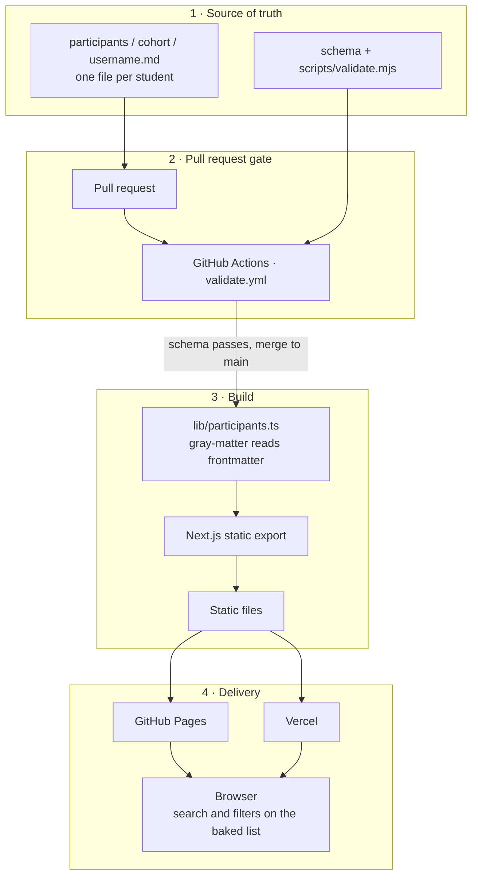

# Iqra Workshop Wall

Repository: [umar9991/Iqra-University-Workshop](https://github.com/umar9991/Iqra-University-Workshop)

A living wall of the students who learned Git, GitHub and AI-assisted coding at
Iqra University Computer Science workshops. Each participant adds **one file**;
a pull request puts their card on the site automatically.

Built with **Next.js** (static export) so it deploys the same to **Vercel** or
**GitHub Pages**. Themed in Iqra navy, warm paper, and gold.

---

## Architecture

A static site. Markdown files are the only database. There is no login, no write API, and no server at runtime. A card exists because a file was merged, the build read it, and the host served the result.



| Boundary | What it owns | What it refuses |
| --- | --- | --- |
| Source of truth | One markdown file per person, under `participants/<cohort>/` | A shared JSON list. Separate files are what keep a whole class from colliding. |
| Pull request gate | `validate.yml` runs `npm run validate` when participant, schema, or script files change | A missing field, a wrong type, or a file that does not match the template |
| Build | `lib/participants.ts` reads every card once, while Next.js exports the site | A database, a session, or a request-time lookup |
| Delivery | GitHub Pages (`DEPLOY_TARGET=pages`) or Vercel serves the export | A runtime that can write a card. Search on the roster runs in the browser on the list compiled at build time. |

## Run locally

```bash
npm install
npm run dev          # http://localhost:3000
npm run build        # static export to ./out
npm run validate     # check all participant cards against the schema
```

## Deploy

**Vercel (recommended):** import the repo on vercel.com — it detects Next.js and
deploys on every push. Delete `.github/workflows/deploy.yml` if you use Vercel.

**GitHub Pages:** in repo Settings → Pages, set Source to **GitHub Actions**.
The included `deploy.yml` builds with `DEPLOY_TARGET=pages` (which sets the
`basePath`) and publishes `./out`.

## Running a workshop

1. Participants **fork** the repo and open it in **Cursor**.
2. They run **`/do-task`** — Cursor interviews them and writes their card file
   (see `.cursor/commands/do-task.md`), then suggests the commit.
3. They push and open a PR. `validate.yml` checks it; you merge; it deploys.

This teaches the real workflow — fork, branch, commit, PR, CI — plus
AI-assisted ("vibe") coding, in one sitting.

## Make it yours

- **Theme:** colours live as tokens at the top of `app/globals.css` (`--navy`,
  `--gold`, `--paper`…). Swap the hex values to rebrand.
- **Fancier animations:** drop in components from
  [reactbits.dev](https://reactbits.dev) (copy-paste React, works here) — good
  spots are the hero title and the card hover. The base build keeps motion to
  one orchestrated reveal on purpose, so add deliberately.
- **New workshop:** create a new folder, e.g. `participants/2027-spring/`, and
  point `/do-task` and the Cursor rule at it. Cohort tabs appear automatically.

## Structure

```
app/                 routes: overview, roster, git sheet, workflow, architecture
components/          sidebar shell, roster, cards, command sheet
lib/nav.ts           sidebar map — add a page here when you add a route
lib/git-commands.ts  the Git command sheet
lib/participants.ts  reads the markdown at build time
participants/        one .md per person, grouped by cohort
template/            the file students copy
schema/              JSON schema the PR check validates against
scripts/validate.mjs the check
.cursor/             /do-task command + project rule
.github/workflows/   PR validation + Pages deploy
```
